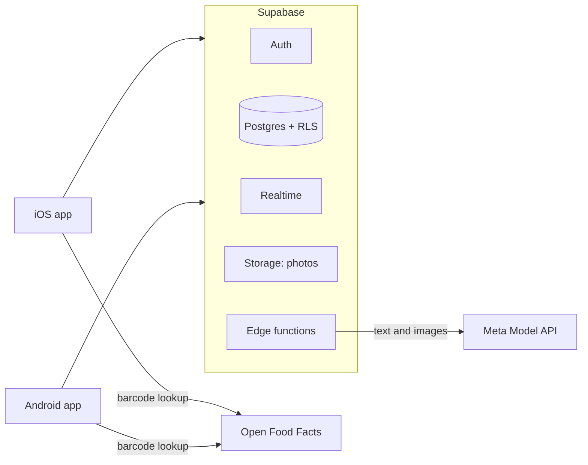

# Architecture

_Draft, 2026-10-28._

## Tech stack

| Layer | Choice | Status |
|-------|--------|--------|
| iOS app | Swift, SwiftUI; ships first | decided ([0002](decisions/0002-native-mobile-apps.md)) |
| Android app | Kotlin, Jetpack Compose; after the hackathon | decided ([0002](decisions/0002-native-mobile-apps.md)) |
| Backend | Supabase (EU, Frankfurt): Postgres, Auth, Realtime, Storage, Edge Functions | decided ([0004](decisions/0004-backend.md)) |
| AI | Meta Model API, `muse-spark-1.2` for text and images, called only from the backend | decided ([0003](decisions/0003-meta-muse-models.md)) |
| Barcode scanning | On device: Apple VisionKit, Google ML Kit | proposed |
| Product and nutrition data | Open Food Facts API | proposed |
| Voice input | On-device speech-to-text, then the same text parser as typed input | proposed |

## Repo layout

```
ios/         SwiftUI app
android/     Kotlin / Compose app
supabase/    migrations (schema, RLS) and edge functions
docs/        product and technical docs
```

## Components



- **Thin apps:** AI calls, ingredient matching and price maths live on the backend, so each is built once and both platforms behave the same.
- **Household privacy:** household data (pantry, plans, lists, recipes, receipts) is only visible to that household's members, enforced by Row Level Security.
- **Shared catalogue:** products, shops, aliases and anonymous price observations are shared by everyone ([0005](decisions/0005-pooled-price-data.md)).
- **Live sharing:** Realtime pushes shopping list and pantry changes to every member's phone.

## AI functions

Each is an edge function that calls Muse Spark and returns JSON validated against a schema. Every function also takes the app's `locale` and answers in that language ([0006](decisions/0006-app-languages.md)).

| Function | Input | Output |
|----------|-------|--------|
| `recipe-generate` | prompt, pantry, household preferences | new recipe, with a cover colour 1–6 ([design](design/design-system.md#recipe-covers)) |
| `recipe-edit` | current version, change request | next version of the same variant |
| `recipe-variant` | recipe, missing items or wanted change | new variant |
| `pantry-parse` | free text (typed or transcribed) | items with quantity, unit, estimated expiry |
| `meal-plan` | pantry with expiry dates, preferences | tomorrow's meals and missing items |
| `receipt-parse` | receipt photo | shop, date, lines (name, quantity, price), matched products |
| `label-read` | label photo | expiry date |

## Data model

**Shared by everyone:**

| Entity | Key fields |
|--------|------------|
| `product` | canonical name, category, default unit, barcode, nutrition |
| `shop` | chain, branch, country, currency |
| `product_alias` | shop chain + raw receipt text → product |
| `price_observation` | product, shop, unit price, currency, date (no household link) |

**Private to a household:**

| Entity | Key fields |
|--------|------------|
| `household`, `member`, `invite` | who belongs to which household; invite code |
| `pantry_item` | product, quantity, unit, expires_on |
| `recipe` → `recipe_variant` → `recipe_version` | variant name ("Original", "No eggs"); version content (ingredients, steps) and change note |
| `meal_plan_entry` | date, meal, recipe variant |
| `shopping_list_item` | product, quantity, checked, checked_by |
| `receipt` → `receipt_line` | shop, date, total, photo; line: raw text, product, quantity, unit price |

**Price comparison** is a query over `price_observation`: the latest unit price per product per shop, in the same currency, summed over the current shopping list. Money is always stored with its currency (RON first, EUR later).

## Ingredient matching

The same food shows up as "2 cloves garlic" (recipe), "GARL 250G" (receipt) and "garlic" (pantry).

1. Every recipe ingredient, pantry item, list item and receipt line points to a `product`.
2. Receipt lines are looked up in `product_alias` for that shop chain first; only unknown lines go to the AI.
3. The AI gets candidate products from the shared catalogue and must pick one or propose a new one.
4. Units convert through a small table (g/kg, ml/l, pieces), plus per-product rules where needed (1 clove of garlic ≈ 5 g).
5. When a user corrects a wrong match, it's saved as an alias, so every household benefits.

## External services

- Meta Model API: `https://api.meta.ai/v1`
- Open Food Facts: barcode lookup and nutrition
