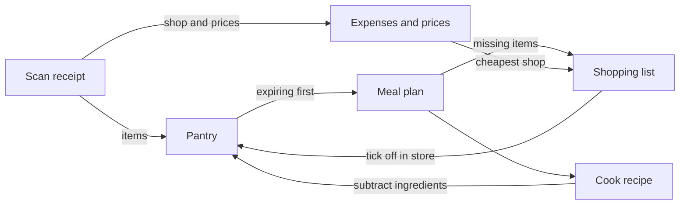

# Brainstorm

Raw ideas. Anything goes here; nothing is committed to until it moves into [requirements.md](requirements.md).

Status tags: `new` → `exploring` → `mvp` / `later` / `dropped`

## The core loop

Every idea fits one loop, shared by the whole household: the pantry feeds the plan, the plan drives shopping, and shopping and cooking update the pantry.

## Ideas by area

### Households and accounts

- `mvp` Sign up, create a household, invite family members with a link or code.
- `mvp` Pantry, meal plan, shopping list and expenses belong to the household and update live for everyone.
- `new` Per-member dietary needs and allergies that every recipe respects.
- `new` See who ticked what on the shopping list.

### Recipes

- `mvp` Generate a recipe from a prompt ("quick dinner, high protein, uses spinach").
- `mvp` Refine in place: ask for a change and the same recipe updates. No growing chat.
- `mvp` Variants: when an ingredient is missing or you want a change, create a variant ("no eggs", "chicken instead of tofu") next to the original and switch between them.
- `mvp` Version history per variant: see what changed, undo a change.
- `mvp` Recipes prefer pantry ingredients, flag anything missing, and offer a variant that avoids it.
- `new` Scale servings; save favourites.
- `new` A generated photo for each recipe (Muse Image, $0.01 each; see [ai-models.md](ai-models.md)).

### Pantry (stock)

- `mvp` Quick add by typing or speaking a list ("6 eggs, half a bag of rice, spinach"); the LLM turns it into items.
- `mvp` Quantity and expiry date per item; expiry estimated from the product type when unknown.
- `mvp` Cooking a recipe subtracts its ingredients from stock.
- `new` Quick corrections ("out of milk") so stock stays trustworthy.
- `new` Rough mode for staples (have / low / out) instead of exact amounts for salt, oil, spices.

### Meal planning

- `mvp` Plan tomorrow's meals, using items that expire soonest first.
- `mvp` Turn the plan into a shopping list for whatever is missing.
- `new` Plan a whole week.

### Shopping list

- `mvp` Generated from the meal plan minus the pantry; items can also be added by hand.
- `mvp` Shared and live: tick items off in the store, big tap targets, one-handed.
- `mvp` Ticking an item adds it to the pantry, so restocking needs no extra input.
- `mvp` Suggest the cheapest shop for the current list, based on price history.
- `new` Split suggestion: "buy these at shop A and those at shop B" when that's cheaper overall.
- `new` Works offline (poor signal in stores).

### Scanning

- `mvp` Receipt: extract the shop, date, items, quantities and prices. Items go into the pantry; prices go into expenses and price history.
- `mvp` Barcode: product name and nutrition (e.g. from Open Food Facts).
- `mvp` Expiry date from a photo of the label.
- `new` Stock scan: photograph the fridge or a shelf, or sweep the camera, to add several items at once. Photos, not video, for now ([ai-models.md](ai-models.md#stock-scan-photos-not-video-for-now)).

### Expenses and prices

- `mvp` Spending per shop, week and month.
- `mvp` Price history per product and shop, to spot price increases.
- `mvp` Compare the same product across shops.
- `mvp` Pool anonymous price data across all households, so comparisons work even for shops you haven't visited ([0005](decisions/0005-pooled-price-data.md)).

### Nutrition

- `mvp` Nutrition per product from barcode data.
- `new` Nutrition per recipe and per day, calculated from ingredients.

## Hard parts to solve early

- **Matching names and units:** the recipe says "2 cloves garlic", the receipt says "GARL 250G", the pantry says "garlic". Stock deduction, shopping lists and price comparison all depend on mapping these to the same product.
- **Comparing shops:** different shops print the same product differently on receipts, so price comparison only works if matching is good.
- **Stock drift:** people won't log everything, so quantities slowly go wrong. Corrections have to be effortless.
- **Expiry dates:** standard barcodes don't contain them, so they come from a photo of the label or an estimate.
- **Receipt formats** differ by store and country.
- **Deadline:** the full loop, households and scanning on two native apps by 4 Nov.

## Open questions

- App language: English (for the judges), Romanian (for the family), or both? Recipes could follow the user's language either way.
- How well does Open Food Facts cover products sold in Romania? Check early with a few real barcodes.
- Voice input in Romanian: Muse Voice Transcribe doesn't support it. Does Apple's on-device speech recognition handle Romanian well enough, or should we send audio to Muse Spark 1.2?

## Decided

- Everything marked `mvp` above is in the hackathon MVP; see [roadmap.md](roadmap.md).
- Households from day one, and open to other users.
- Mobile only, native. iOS first for the hackathon, Android after ([0002](decisions/0002-native-mobile-apps.md)).
- Meta Muse models first, swappable later ([0003](decisions/0003-meta-muse-models.md)).
- Supabase backend, hosted in the EU ([0004](decisions/0004-backend.md)).
- Romania first (RON), then Europe (EUR).
- Prices pooled anonymously across all households ([0005](decisions/0005-pooled-price-data.md)).
- Hackathon: indie track.
