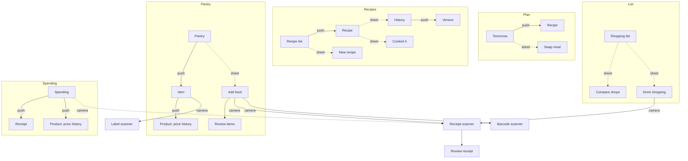

# Navigation

_Approved by the user 2026-10-28. Decision: [0007](../decisions/0007-navigation.md)._

## Tabs

Five tabs, the most an iPhone tab bar holds without "More". Same tabs as [#22](https://github.com/traista-eugen/merinde/issues/22), with Plan moved first.

| # | Tab (EN / RO) | Symbol | Root screen | Why |
|---|---------------|--------|-------------|-----|
| 1 | Plan / Plan | `calendar` | Tomorrow: meals, "use soon" strip, missing items | Starts the daily loop, and the first screen shows the whole idea: a plan built from what's about to expire |
| 2 | Recipes / Rețete | `book.closed` | Recipe list | The hero feature; also reached from every planned meal |
| 3 | List / Listă | `checklist` | Shopping list with cheapest shop | Opened in the store; the middle tab is easiest to reach |
| 4 | Pantry / Cămară | `refrigerator` | Pantry sorted by expiry | Where food comes in: typing, voice, scans |
| 5 | Spending / Cheltuieli | `chart.bar` | Week and month totals, price changes | Weekly use; prices and receipts live here |

- The app reopens on the last-used tab (`@SceneStorage`). First launch opens Plan.
- Until Plan is built (1 Nov), the skeleton can default to Recipes. Tab order is a one-line change.

## Screen map

Solid arrows push; dotted arrows open a sheet; cameras open full screen.

## Where things live

| Thing | Where | Why |
|-------|-------|-----|
| Scanning | No Scan tab. Each scanner opens from the screen where its result lands | HIG: tabs navigate, they don't perform actions. The three scans feed different places |
| Receipt scan | List → Done shopping; Spending → `+`; Pantry → Add food | After shopping is when you hold the receipt |
| Barcode scan | Pantry → Add food → Scan barcode | Result is a product to add |
| Expiry label | Pantry item → Read date from label; the Add food review row | Result is a date on one item |
| Household and settings | Household button (member initials) at the top left of every tab root → Household sheet | One household per user in MVP, so no switcher. The faces remind you the data is shared |
| Price history | Product page, pushed from a pantry item, list item, receipt line or Spending's price changes | Prices belong to products |
| Cooked it | Recipe: button under the steps, and the More menu | You're on the recipe when you finish cooking |
| Add to plan | Recipe → More → Add to tomorrow | |

## Toolbar pattern

| Position | Root screens | Pushed screens |
|----------|--------------|----------------|
| Top left | Household button | Back |
| Title | Large, serif | Inline, SF Pro |
| Top right | One primary action: `+` (Recipes, Pantry, Spending) | Screen actions, then `…` More menu |

## Household sheet

- Household name and members (initials, "You").
- Invite: `ShareLink` with the code and link; shows the 6-character code large.
- Language: "Follows your iPhone (English)", opens the app's page in Settings.
- Privacy: how prices are pooled ([0005](../decisions/0005-pooled-price-data.md)).
- Sign out.

## First run

1. **Welcome:** a cooking video across the top half, fading into `Paper`; horizontal logo lockup ([brand.md](brand.md)) and the "food packed for the road" line; three one-line features; Sign in with Apple (`SignInWithAppleButton`, black in light mode, white in dark), Continue with email. Video spec below.
2. **Household:** Create one (name it) or Join with a code. An invite link opens this step with the code filled in.
3. **Plan tab**, with empty states pointing to Add food and New recipe.

### Welcome video

| | |
|-|-|
| Content | Cooking close-ups (chopping, a pan, steam), warm light that suits the paprika and cream palette. No text, logos or faces; the wordmark sits on top |
| Format | Portrait 9:16, 1080×1920, H.264 or HEVC `.mp4`, no audio track, under ~4 MB, bundled in the app |
| Loop | 6–10 s, seamless (last frame matches the first) |
| Framing | Keep the action in the top 60%; the bottom fades into `Paper` |
| Poster | First frame as an image asset, shown until the video plays |
| Playback | `AVQueuePlayer` + `AVPlayerLooper` in an `AVPlayerLayer` (not SwiftUI `VideoPlayer`, which shows controls); muted; doesn't interrupt the user's music (`.ambient` audio session) |
| Reduce Motion, Low Power Mode | Show the poster, don't play |
| VoiceOver | Hidden (decorative) |

## Considered and rejected

| Option | Why not |
|--------|---------|
| Scan tab in the middle | A tab that triggers an action breaks HIG, and three scans feed three places |
| Settings tab | Too little in it; one household per user |
| Spending under Pantry or in "More" | Hides a feature the demo needs; five tabs fit |
| Recipes first | Plan is the daily starting point and shows the loop; recipes are one tap away from any meal |
